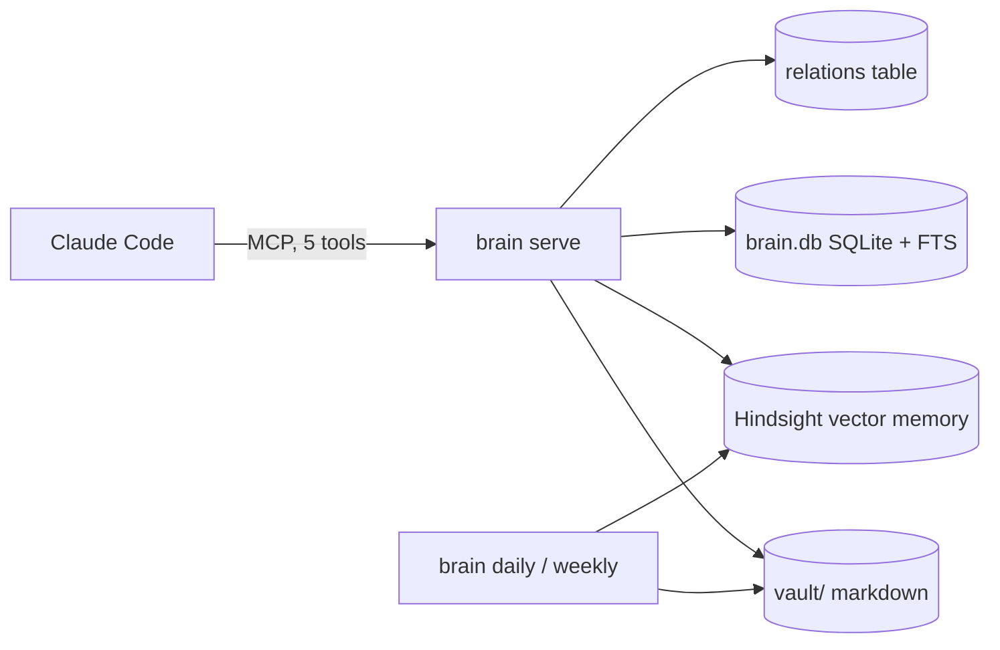

# brain-core

**A memory for your Claude Code agent that survives the session.** One local MCP server, five tools, a markdown vault you can read, an eval that proves recall. Installs with one command.

[](https://github.com/xy-claude/brain-core/actions/workflows/test.yml)
[](LICENSE)
[](pyproject.toml)

```
curl -fsSL https://raw.githubusercontent.com/xy-claude/brain-core/main/install.sh | bash -s -- --agent Atlas --user Alex
```

---

## The problem

Every session with a coding agent starts from zero. You explain the project again, the decision you made last week again, the thing it got wrong on Tuesday again. Memory add-ons exist, but they put your notes in someone's cloud, expose 30 tools the agent cannot choose between, and nobody shows you an eval.

brain-core is the opposite: local, five tools, markdown files you own, and a test suite that reports hit rates.

## What you get



| Tool | One call does |
|---|---|
| `brain_session('start')` | the whole start block: daily brief, executive state, mental models, a recall per mission, inbox count, and a flag if the last session crashed |
| `brain_recall(query)` | one query across every store, deduplicated, ranked by relevance and recency, capped at 6k tokens |
| `brain_remember(text, kind)` | writes vault → SQLite → Hindsight → graph and reports each layer. Near-duplicates are skipped; a changed value gets a `⚠ Fact changed` banner and the old line stays |
| `brain_distill(source)` | captures a URL, GitHub repo, YouTube video, PDF, file or pasted text into an immutable `raw/` folder for the agent to compile |
| `brain_session('end')` | drains the queue, closes the day's session file, rewrites state and critique, writes the clean-close marker |

Plus `brain_status()` for health in one call, and two cron jobs that write the next morning's brief, back up memory, and archive old sessions.

## Install

### macOS, one line

```bash
curl -fsSL https://raw.githubusercontent.com/xy-claude/brain-core/main/install.sh | bash -s -- --agent Atlas --user Alex
```

What it does, in order (re-running skips what is already there):

```
== 1/8 Xcode command line tools      present
== 2/8 Homebrew                      present
== 3/8 uv, gh, gitleaks, node, Claude Code
== 4/8 brain-core (v0.2.0)           installed with uv tool
== 5/8 Agent Atlas at ~/Agents/Atlas  31 files written
== 6/8 Hindsight (required store)    service: healthy
== 7/8 Cron                          daily 06:07, weekly Sun 07:13
== 8/8 Doctor                        Brain: OK
```

Then, once: `export ANTHROPIC_API_KEY=...` (Hindsight uses it to reason over memories), and `claude` to sign in to Claude Code.

| Flag | Meaning |
|---|---|
| `--agent NAME` | the agent's name (required) |
| `--user Alex` | how the agent addresses you |
| `--dir PATH` | where the agent lives, default `~/Agents/NAME` |
| `--provider` | `anthropic` (default), `openai`, or `claude-code` (uses your Claude Code login; personal use only) |
| `--profile DIR` | a folder copied over the generic rules last, for your own doctrine |
| `--dashboard` | the Hindsight web UI on http://localhost:9999 |
| `--ref v0.2.0` | pin a release |

### Manual, any platform

```bash
uv tool install git+https://github.com/xy-claude/brain-core@v0.2.0
brain init Atlas --path ~/Agents/Atlas --user Alex
brain hindsight install          # macOS launchd; on Linux run hindsight-api yourself
brain cron install ~/Agents/Atlas
brain doctor ~/Agents/Atlas
```

## First session

```bash
cd ~/Agents/Atlas && claude
```

The agent's `CLAUDE.md` tells it to open with `brain_session('start')`. What comes back:

```json
{
  "session_id": "s-20261102-a1b2c3",
  "brief": "# Daily Brief — 2026-11-02 ...",
  "executive_state": "## Primary Objective ... ## Top Missions ... ## Pending Decisions ...",
  "mental_models": {"active-priorities": "..."},
  "missions": {"M-001 first mission": [ ...3 recall hits... ]},
  "inbox": 0,
  "recovery": null
}
```

Say something worth keeping and the agent calls `brain_remember`:

```json
{"status": "written", "layers": {"vault": {"status": "written", "detail": "facts.md › System"},
                                 "sqlite": {"status": "written"},
                                 "hindsight": {"status": "written", "detail": "op 162bdbaa"}}}
```

Say "thanks, we're done" and it runs `brain_session('end')`. Tomorrow at 06:07 `brain daily` writes the next brief from what you did today.

## What is in the agent folder

```
~/Agents/Atlas
├── CLAUDE.md                 identity and the five-tool protocol (3k tokens always loaded)
├── .claude/
│   ├── rules/                01-identity 02-doctrine 03-authority 04-memory 05-system
│   ├── skills/               distill, session-end, brain-check
│   └── hooks/                block-dangerous-bash.sh (rm -rf, force-push, curl|sh …)
├── .mcp.json                 brain serve . + Hindsight
├── brain.yaml                stores, session files, cron schedule
├── vault/                    facts.md patterns.md decisions_log.md corrections.md
│   ├── sessions/             one file per day (HSAM)
│   ├── knowledge/ raw/       the LLM-wiki: immutable sources, compiled pages
│   └── executive_state.md    objective, missions, pending decisions
└── data/brain.db             SQLite + FTS5 + relations
```

Everything is markdown or SQLite. Open the vault in Obsidian, grep it, commit it, delete a line. The agent will not mind.

## Does it work?

The eval is part of the test suite and runs in CI.

| Set | Hits |
|---|---|
| 20 recall tasks on a synthetic fixture vault (CI) | 20 / 20 |
| 20 tune + 10 held-out recall tasks on the author's real vault, 7 months of sessions | 20 / 20 and 10 / 10 |
| 11 write scenarios: dedup, value-change banner, relation routing, secret refusal | 11 / 11 |

Recall takes about 1.7 s per query; Hindsight is the floor. A full start block is about 4 s and under 6k tokens.

```bash
python tests/eval/run_recall.py --config ~/Agents/Atlas/brain.yaml   # your own vault
```

## How memory is organised

| Kind | Lives in | Written as |
|---|---|---|
| fact | `vault/facts.md` under `## Domain` | `- text (date)` |
| pattern | `vault/patterns.md` | `- **title** — text (date)` |
| decision | `vault/decisions_log.md` | `## date — title` + Decision / Reason / Classification / Confidence |
| correction | `vault/corrections.md` | `### [date] title` + Error / Correction / Implied rule / Theme |
| note | `vault/sessions/YYYY-MM-DD.md` | a bullet under an HSAM section |
| relation | `data/brain.db` | subject —[predicate]→ object |
| raw | `vault/raw/` | immutable source with sha256; the agent compiles `vault/knowledge/` |

Rules: idempotent by content hash, append-only, nothing deleted, secrets refused before any store sees them. Details in [`docs/VAULT_SCHEMA.md`](docs/VAULT_SCHEMA.md).

## Requirements

- macOS for the installer (launchd); the library and MCP run anywhere Python 3.12 does
- [Hindsight](https://github.com/vectorize-io/hindsight) (MIT) as the vector store, installed for you. Postgres is embedded; embeddings run on CPU
- an LLM key for Hindsight's reasoning, or a Claude Code login for personal use

## Roadmap

- PyPI release so `uv tool install brain-core` needs no git URL
- Linux installer (cron instead of launchd)
- SQLite-only mode for a first run without Hindsight
- an `import` for existing notes folders

Shipped milestones: [`docs/MILESTONES.md`](docs/MILESTONES.md). Design: [`docs/SPEC_v0.2.md`](docs/SPEC_v0.2.md). Threat model for a memory that reads untrusted text: [`docs/THREAT_MODEL.md`](docs/THREAT_MODEL.md).

## Contributing

Issues and pull requests welcome. `uv sync --all-extras --all-groups`, then `ruff check`, `mypy`, `pytest`. See [`CONTRIBUTING.md`](CONTRIBUTING.md).

## License

MIT.
