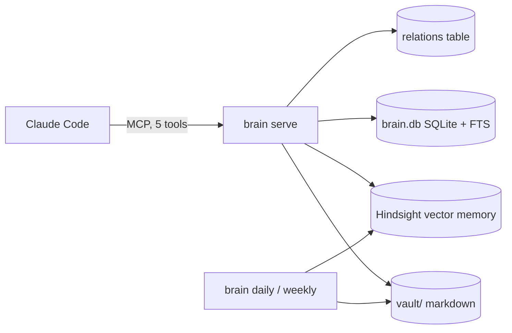
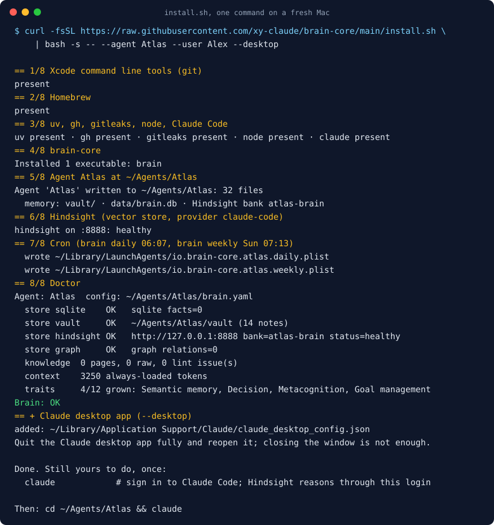
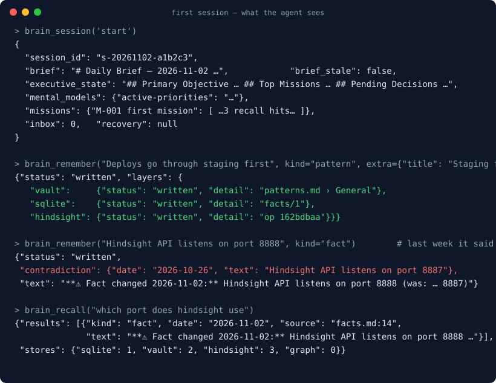

[](https://github.com/xy-claude/brain-core/actions/workflows/test.yml)
[](LICENSE)
[](pyproject.toml)
[](https://glama.ai/mcp/servers/xy-claude/brain-core)
<!-- mcp-name: io.github.xy-claude/brain-core -->


# brain-core

**A memory for your Claude Code agent that survives the session.** One local MCP server, five tools, a markdown vault you can read, an eval that proves recall. Installs with one command.

brain-core gives a Claude Code agent a long-term memory that lives on your disk. You name the agent, you tell it who you are, and from then on every session opens with yesterday's brief, the decisions you made, the facts that changed and the corrections you gave. It remembers by writing markdown files you can open in any editor, and it finds things again through a local SQLite index plus [Hindsight](https://github.com/vectorize-io/hindsight), a self-hosted vector memory. Nothing leaves your machine except the LLM calls you already make.

It is for one person running one or more agents on their own computer: a solo developer, a founder, anyone tired of re-explaining their project every morning. It is not a hosted service and not a team product.

### Is it an MCP server or a tool?

Both. One Python package, three ways in:

| Piece | What it is | Who uses it |
|---|---|---|
| `brain serve` | an MCP server that Claude Code starts from the agent's `.mcp.json` and that exposes five tools | the agent, every session, without you touching it |
| `brain` command | a CLI: `brain init`, `brain doctor`, `brain index`, `brain hindsight install`, `brain cron install`, `brain daily`, `brain weekly` | you, once at setup, then cron |
| `brain_core.Agent` | the Python library both of the above sit on | the eval runner, the demo script, your own scripts |

To a Claude Code user: an MCP server with five memory tools and a one-line installer. To a Python developer: a memory library with an MCP front end.

```
curl -fsSL https://raw.githubusercontent.com/xy-claude/brain-core/main/install.sh | bash -s -- --agent Atlas --user Alex
```


---

## The problem

Every session with a coding agent starts from zero. You explain the project again, the decision you made last week again, the thing it got wrong on Tuesday again. Memory add-ons exist, but they put your notes in someone's cloud, expose 30 tools the agent cannot choose between, and nobody shows you an eval.

brain-core is the opposite: local, five tools, markdown files you own, and a test suite that reports hit rates.

## How it works

1. **`brain init` scaffolds an agent folder.** It writes a `CLAUDE.md` with the agent's name and yours, five rule files (identity, doctrine, authority, memory, system), three skills, a safety hook, an `.mcp.json` and an empty vault. Claude Code reads that folder as a project, so the agent knows how to use its memory from the first message.
2. **`brain serve` runs as an MCP server inside Claude Code.** It exposes exactly five tools. The agent calls them the way it calls any other tool; you never run them by hand.
3. **Every session has a shape.** The agent opens with `brain_session('start')`, which returns one block: today's brief, the executive state, the mental models, a recall per active mission, and a flag if the previous session crashed. It closes with `brain_session('end')`, which files the day's archive and rewrites state for tomorrow.
4. **Memory is written, not inferred.** When you say something worth keeping, the agent calls `brain_remember(text, kind)`. The text goes to the vault first, then the SQLite index, then Hindsight, then the relations table, and the reply says what each layer did. A duplicate is skipped. A fact whose value changed gets a `⚠ Fact changed` banner and the old line stays, so the history is visible.
5. **Recall is one query across every store.** `brain_recall(query)` searches the vault, the index and Hindsight at once, deduplicates, ranks by relevance and recency, and caps the reply at 6k tokens so it never floods the context.
6. **Two cron jobs do the housekeeping.** `brain daily` writes the next morning's brief and backs up Hindsight. `brain weekly` archives sessions older than 30 days into a monthly summary and refreshes the mental models.



## The five tools

| Tool | One call does |
|---|---|
| `brain_session('start')` | the whole start block: daily brief, executive state, mental models, a recall per mission, inbox count, and a flag if the last session crashed |
| `brain_recall(query, scope)` | one query across every store, the Claude Code transcripts of this folder and any `stores.notes` folders included, deduplicated, ranked by relevance and recency, capped at 6k tokens; `scope='transcript'` is what past sessions said and ran, useful on day one |
| `brain_remember(text, kind)` | writes vault → SQLite → Hindsight → graph and reports each layer. Near-duplicates are skipped; a changed value gets a `⚠ Fact changed` banner and the old line stays |
| `brain_distill(source)` | captures a URL, GitHub repo, YouTube video, PDF, file or pasted text into an immutable `raw/` folder for the agent to compile |
| `brain_session('end')` | drains the queue, closes the day's session file, rewrites state and critique, writes the clean-close marker |

Plus `brain_status()` for health in one call: which stores are up, how many tokens the always-loaded context costs, whether a session is open, and which decisions are waiting on you.

## Install

### Before you start

| You need | Why | Check |
|---|---|---|
| macOS, or Linux with systemd | the installer sets up a background service and cron | `uname` |
| about 2 GB of disk and 10 minutes, or `--lite` | Hindsight ships an embedded Postgres and a CPU embedding model; `--lite` skips it | |
| an Anthropic API key, or a Claude Code login, or `--lite` | Hindsight uses an LLM to reason over memories | `echo $ANTHROPIC_API_KEY` |
| Claude Code | the agent runs inside it; the installer adds it if missing | `claude --version` |

Pick two names before you run the command: the agent's name (`--agent`), which becomes its folder and identity, and your own (`--user`), which is how the agent addresses you. Both can be changed later by editing `CLAUDE.md`.

### macOS, one line



```bash
curl -fsSL https://raw.githubusercontent.com/xy-claude/brain-core/main/install.sh | bash -s -- --agent Atlas --user Alex
```

In a hurry, or no 2 GB to spare? Add `--lite`: vault plus SQLite full-text search, no Hindsight, installed in about a minute. Everything in the five tools works; what you give up is semantic recall over paraphrases, mental models and the weekly reflection. The recall numbers in [Does it work?](#does-it-work) are measured on exactly this configuration. Upgrade any time with `brain hindsight install`, then uncomment the `hindsight:` block in `brain.yaml`.

```bash
curl -fsSL https://raw.githubusercontent.com/xy-claude/brain-core/main/install.sh | bash -s -- --agent Atlas --user Alex --lite
```

What it does, in order. Re-running skips what is already there, so after a failure you fix the cause and run the same line again.

```
== 1/8 Xcode command line tools      present
== 2/8 Homebrew                      present
== 3/8 uv, gh, gitleaks, node, Claude Code
== 4/8 brain-core (v0.4.0)           installed with uv tool
== 5/8 Agent Atlas at ~/Agents/Atlas  31 files written
== 6/8 Hindsight (required store)    service: healthy
== 7/8 Cron                          daily 06:07, weekly Sun 07:13
== 8/8 Doctor                        Health check: OK
```

| Step | What happens | If it stops here |
|---|---|---|
| 1 | checks for `git` via the Xcode command line tools | macOS opens an install dialog; finish it, then re-run |
| 2 | installs Homebrew if missing | Homebrew asks for your password itself |
| 3 | installs `uv`, `gh`, `gitleaks`, `node` and Claude Code with Homebrew | anything already present is left alone |
| 4 | installs the `brain` command from PyPI with `uv tool` | `--ref v0.4.0` pins a git tag instead |
| 5 | runs `brain init` and writes the agent folder | an existing `brain.yaml` is never overwritten |
| 6 | installs Hindsight as a launchd service on `127.0.0.1:8888` | first start downloads the embedding model; give it a few minutes |
| 7 | installs `brain daily` and `brain weekly` as launchd agents | |
| 8 | runs `brain doctor` on the new agent | `brain doctor ~/Agents/Atlas` repeats it any time |

### After the installer

Two things the installer cannot do for you:

```bash
export ANTHROPIC_API_KEY=sk-ant-...     # add it to ~/.zshrc too
brain hindsight install                 # copies the key into ~/.config/hindsight/env (mode 600) and restarts the service
claude                                  # sign in to Claude Code once
```

The installer prints a note if the key was not in your shell when it ran. If you would rather not use an API key, pass `--provider claude-code` and Hindsight uses your Claude Code login instead. That mode is for personal use only.

| Flag | Meaning |
|---|---|
| `--agent NAME` | the agent's name (required) |
| `--user Alex` | how the agent addresses you |
| `--dir PATH` | where the agent lives, default `~/Agents/NAME` |
| `--provider` | `anthropic` (default), `openai`, or `claude-code` (uses your Claude Code login; personal use only) |
| `--api-key-env VAR` | read the key from a variable other than `<PROVIDER>_API_KEY` |
| `--profile DIR` | a folder copied over the generic rules last, for your own doctrine |
| `--lite` | skip Hindsight: vault + SQLite only, upgrade later |
| `--dashboard` | the Hindsight web UI on http://localhost:9999 |
| `--ref v0.4.0` | pin a git tag instead of the PyPI release |

### Linux

The same one line. It needs `git` and `curl` already present. It then installs `uv` from astral.sh, installs Claude Code with npm when node is present, runs Hindsight as a `systemd --user` service, and writes the two jobs into your user crontab as tagged lines it can find and replace on re-run.

### Manual, any platform

```bash
uv tool install brain-core-mcp   # or: uv tool install git+https://github.com/xy-claude/brain-core@v0.4.0
brain init Atlas --path ~/Agents/Atlas --user Alex
brain hindsight install          # launchd on macOS, systemd --user on Linux
brain cron install ~/Agents/Atlas
brain doctor ~/Agents/Atlas
```

### Check it worked

```bash
brain doctor ~/Agents/Atlas
```

It prints the agent name, the config path, row counts per table, and `Health check: OK`. Store health shows up in the first `brain_session('start')` reply and in `brain_status()`. The common problems:

| Symptom | Cause | Fix |
|---|---|---|
| `brain: command not found` | the `uv tool` bin folder is not on your PATH | `uv tool update-shell`, then open a new terminal |
| `ERROR: no brain.yaml at ...` | wrong path | pass the agent folder, or the `brain.yaml` inside it |
| `hindsight unreachable at http://127.0.0.1:8888` | the service is still starting, or not installed | wait a minute; still down, run `brain hindsight install` |
| installer note `ANTHROPIC_API_KEY is not set in this shell` | the key was not in the shell when the service was installed | export it, then `brain hindsight install` again; it rewrites `~/.config/hindsight/env` |
| Claude Code shows no `brain` tools | it was started outside the agent folder | `cd ~/Agents/Atlas && claude`, then `/mcp` to confirm |

## First session



```bash
cd ~/Agents/Atlas && claude
```

The agent's `CLAUDE.md` tells it to open with `brain_session('start')`. What comes back:

```json
{
  "session_id": "s-20261102-a1b2c3",
  "brief": "# Daily Brief — 2026-11-02 ...",
  "executive_state": "## Primary Objective ... ## Top Missions ... ## Pending Decisions ...",
  "mental_models": {"active-priorities": "..."},
  "missions": {"M-001 first mission": [ ...3 recall hits... ]},
  "inbox": 0,
  "recovery": null
}
```

On day one the brief is empty and the executive state is the template. That is expected. Spend the first session telling the agent what you are working on: the project, the stack, the decisions already made, how you like to work. Each statement that matters becomes a `brain_remember` call, and the reply shows what every layer did:

```json
{"status": "written", "layers": {"vault": {"status": "written", "detail": "facts.md › System"},
                                 "sqlite": {"status": "written"},
                                 "hindsight": {"status": "written", "detail": "op 162bdbaa"}}}
```

Things to try in that first session:

- **State a fact, then change it.** "The API listens on 8887." Later: "Correction, it is 8888." The second write returns a `⚠ Fact changed` banner and `vault/facts.md` keeps both lines.
- **Give it a source.** Paste a URL or a GitHub repo and ask it to distill it. The page lands in `vault/raw/` untouched, and the agent compiles a page in `vault/knowledge/`.
- **Ask about something from earlier.** "What did we decide about the database?" is one `brain_recall` call, and each hit names the file it came from.
- **Open the vault in your editor.** Every write you just saw is a line in a markdown file. Edit it if the agent got it wrong.

Say "thanks, we're done" and it runs `brain_session('end')`. Tomorrow at 06:07 `brain daily` writes the next brief from what you did today, and the next `claude` session opens with it.

## What is in the agent folder

```
~/Agents/Atlas
├── CLAUDE.md                 identity and the five-tool protocol (3k tokens always loaded)
├── .claude/
│   ├── rules/                01-identity 02-doctrine 03-authority 04-memory 05-system
│   ├── skills/               distill, session-end, brain-check
│   └── hooks/                block-dangerous-bash.sh (rm -rf, force-push, curl|sh …)
│                             + recall of past sessions when a command fails
├── .mcp.json                 brain serve . + Hindsight
├── brain.yaml                stores, session files, cron schedule
├── vault/                    facts.md patterns.md decisions_log.md corrections.md
│   ├── sessions/             one file per day (HSAM)
│   ├── knowledge/ raw/       the LLM-wiki: immutable sources, compiled pages
│   └── executive_state.md    objective, missions, pending decisions
└── data/brain.db             SQLite + FTS5 + relations + transcript index
```

Everything is markdown or SQLite. Open the vault in Obsidian, grep it, commit it, delete a line. The agent will not mind.

## Does it work?

The eval is part of the test suite and runs in CI.

| Set | Hits |
|---|---|
| 28 recall tasks on a synthetic fixture vault (CI), stratified: 20 single-hop, 2 multi-hop, 1 knowledge-update, 2 abstention, 3 temporal, each run three times (pass^3) | 28 / 28 |
| 20 tune + 10 held-out recall tasks on the author's real vault, 7 months of sessions | 20 / 20 and 10 / 10 |
| 11 write scenarios: dedup, value-change banner, relation routing, secret refusal | 11 / 11 |
| Growth: the fixture brain after thirty days of sessions scores higher than the same brain on day one on every defensible trait signal (CI) | holds |

The slices are the ones the memory benchmarks (LoCoMo, LongMemEval) say a single hit-rate hides: a changed value must outrank the stale one, an unanswerable question must return nothing, a question about a day must surface that day's archive. Recall takes about 1.7 s per query with Hindsight; a full start block is about 4 s and under 6k tokens.

```bash
python tests/eval/run_recall.py --config ~/Agents/Atlas/brain.yaml   # your own vault
```

## Twelve traits, innate and grown

A brain-core agent is born with twelve traits and grows them with experience. Innate is what `brain init` ships and what survives a cold start with the vault wiped; grown is what accumulates in the vault. `brain_status()` scores each from evidence on disk, and `brain daily` logs one line a day so the curve shows over weeks.

| Memory | Control | Social |
|---|---|---|
| Working memory | Learning | User model |
| Episodic memory | Reasoning and planning | Authority |
| Semantic memory | Decision | |
| Procedural memory | Metacognition | |
| | Execution | |
| | Goal management | |

A trait never gets one number. It gets signals, each with a sample size and a verdict: defensible when the answer key comes from a file the agent did not write that session, cost when it is a size or an age, pending when the evidence does not exist yet. Artefact counts and self-written scores are not signals. The list and the research behind it: [`docs/TRAITS.md`](docs/TRAITS.md).

## How memory is organised

| Kind | Lives in | Written as |
|---|---|---|
| fact | `vault/facts.md` under `## Domain` | `- text (date)` |
| pattern | `vault/patterns.md` | `- **title** — text (date)` |
| decision | `vault/decisions_log.md` | `## date — title` + Decision / Reason / Classification / Confidence |
| correction | `vault/corrections.md` | `### [date] title` + Error / Correction / Implied rule / Theme |
| note | `vault/sessions/YYYY-MM-DD.md` | a bullet under an HSAM section |
| relation | `data/brain.db` | subject —[predicate]→ object |
| raw | `vault/raw/` | immutable source with sha256; the agent compiles `vault/knowledge/` |

Rules: idempotent by content hash, append-only, nothing deleted, secrets refused before any store sees them. Details in [`docs/VAULT_SCHEMA.md`](docs/VAULT_SCHEMA.md).

## Requirements

- macOS or Linux for the installer; the library and MCP run anywhere Python 3.12 does
- optional: [Hindsight](https://github.com/vectorize-io/hindsight) (MIT) as the vector store, installed for you unless `--lite`. Postgres is embedded; embeddings run on CPU
- with Hindsight: an LLM key for its reasoning, or a Claude Code login for personal use

On PyPI the package is `brain-core-mcp` (the plain name collides with an unrelated project); the command is still `brain` and the import is still `brain_core`.

## Roadmap

- an `import` for existing notes folders
- a recall-miss log that grows the eval set from real misses

How it compares to claude-mem, mem0 OpenMemory and a plain CLAUDE.md: [`docs/COMPARISON.md`](docs/COMPARISON.md). Shipped milestones: [`docs/MILESTONES.md`](docs/MILESTONES.md). Design: [`docs/SPEC_v0.2.md`](docs/SPEC_v0.2.md). Threat model for a memory that reads untrusted text: [`docs/THREAT_MODEL.md`](docs/THREAT_MODEL.md).

## Contributing

Issues and pull requests welcome. `uv sync --all-extras --all-groups`, then `ruff check`, `mypy`, `pytest`. See [`CONTRIBUTING.md`](CONTRIBUTING.md).

## License

MIT.
