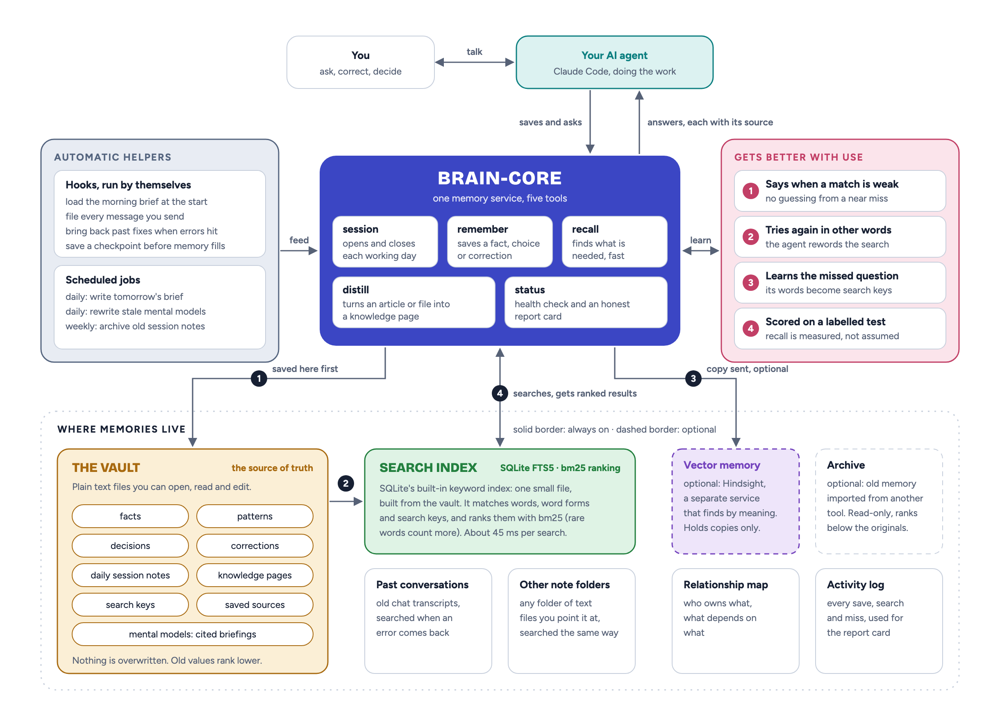

[](https://github.com/xy-claude/brain-core/actions/workflows/test.yml)
[](LICENSE)
[](pyproject.toml)
[](https://glama.ai/mcp/servers/xy-claude/brain-core)
<!-- mcp-name: io.github.xy-claude/brain-core -->


# brain-core

**A memory for your Claude Code agent that survives the session.**

## Install in one line

**macOS and Linux**

```bash
curl -fsSL https://raw.githubusercontent.com/xy-claude/brain-core/main/install.sh | bash -s -- --agent Atlas --user Alex --desktop
```

**Windows** (PowerShell)

```powershell
& ([scriptblock]::Create((irm https://raw.githubusercontent.com/xy-claude/brain-core/main/install.ps1))) -Agent Atlas -User Alex -Desktop
```

`Atlas` is your agent's name, `Alex` is yours. When the installer finishes:

```bash
cd ~/Agents/Atlas
claude
```

Both lines install the same things: the agent, Hindsight (the vector store, about 2 GB), the daily and weekly jobs, Claude Code, and the connection to the Claude desktop app. No API key is needed.

| You want | macOS and Linux | Windows |
|---|---|---|
| The quick install: about a minute, no Hindsight | add `--lite` | add `-Lite` |
| Claude Code only, not the desktop app | remove `--desktop` | remove `-Desktop` |

Every step, every flag and the common problems: [Install details](#install-details).


---

## What you get

- **Sessions that start where the last one ended.** Each one opens with yesterday's brief, your decisions, the facts that changed and the corrections you gave.
- **Five tools, not thirty.** One local MCP server the agent uses by itself.
- **Files you can read.** Memory is markdown in a folder on your disk, indexed by SQLite and, optionally, by [Hindsight](https://github.com/vectorize-io/hindsight), a self-hosted vector memory.
- **Nothing in someone's cloud.** Memory stays on your disk. What does go out: the LLM calls Hindsight makes to reason over memories (none with `--lite`), one version check a day to PyPI, and the pages you ask it to distill.
- **Search you can check.** Every result names its file and date, a weak match is reported as weak, and recall is scored against hand-labelled answers. The numbers, including the ones that are not flattering, are in [Does it work?](#does-it-work)

It is for one person running one or more agents on their own computer. It is not a hosted service and not a team product.

## The problem

Every session with a coding agent starts from zero. You explain the project again, the decision you made last week again, the thing it got wrong on Tuesday again. Memory add-ons exist, but they put your notes in someone's cloud, expose 30 tools the agent cannot choose between, and nobody shows you an eval.

brain-core is the opposite: local, five tools, markdown files you own, and an eval with labelled answers whose numbers are published below.

## How it works

1. **`brain init` scaffolds an agent folder.** It writes a `CLAUDE.md` with the agent's name and yours, five rule files (identity, doctrine, authority, memory, system), three skills, four hooks (a safety block, the brief at session start, capture of what you said, recall of past fixes when a command fails), an `.mcp.json` and an empty vault. Claude Code reads that folder as a project, so the agent knows how to use its memory from the first message.
2. **`brain serve` runs as an MCP server inside Claude Code.** It exposes exactly five tools. The agent calls them the way it calls any other tool; you never run them by hand.
3. **Every session has a shape.** The agent opens with `brain_session('start')`, which returns one block: today's brief, the executive state, the mental models, a recall for each of the top two missions, the inbox count, and a flag if the previous session crashed. In Claude Code a hook has already put the brief in context (at most 3,000 tokens of it), so the block does not repeat it. It closes with `brain_session('end')`, which files the day's archive and rewrites state for tomorrow.
4. **Memory is written, not inferred.** When you say something worth keeping, the agent calls `brain_remember(text, kind)`. The text goes to the vault first, then SQLite, then Hindsight, and a relation also goes to the relations table; the reply says what each layer did. The agent can pass `keys`, the other words you might ask for that memory by, and they are saved in the vault and indexed beside the text. A duplicate is skipped. A fact whose value changed gets a `⚠ Fact changed` banner, the old line stays, and recall ranks the old value below the new one.
5. **Recall is one query, answered from a keyword index.** `brain_recall(query)` searches one SQLite FTS5 index built from every record in the vault and your notes folders. It matches words, word forms, dates written in words, and the search keys saved with each memory, and ranks by bm25 and recency. Hindsight is asked too, unless `stores.hindsight.recall: false` turns that off. Each result names its file and date, a replaced value is marked `superseded`, and the reply is capped at 6k tokens. When nothing holds most of what was asked, the reply says `weak_match`, so the agent searches again in other words and then teaches the memory the question that missed.
6. **Two cron jobs do the housekeeping.** `brain daily` writes the next morning's brief and backs up Hindsight. `brain weekly` archives sessions older than 30 days into a monthly summary, refreshes the mental models, and drafts a rule when the same kind of correction keeps coming back.

<picture>
  <source media="(prefers-color-scheme: dark)" srcset="docs/img/architecture-dark.png">
  
</picture>

## Mental models

Search answers a question. A mental model answers a standing one before it is asked: what the priorities are, how you like to work, what was decided and why. Add a `models:` block to `brain.yaml` and `brain models` writes each as a short markdown file in `vault/models/`:

```
- No git push unless told. He is sole commit author, one short subject line. [patterns.md:120][corrections.md:149]
- Do only what was asked; never bundle "while I'm at it" edits. [patterns.md:94][patterns.md:112]
```

Every claim names the file and line it rests on, and a claim that cites nothing is dropped before the file is written. A model is marked stale only when a record it cited changes or disappears, or when new records match its question. The session start loads them; `brain daily` rewrites the stale ones. The writing is done by your own Claude Code login, or by the Anthropic API with a key (`runner: api`, `uv tool install 'brain-core-mcp[api]'`). They are briefings, not memory: recall never returns them, and the cited line is the source.

## The five tools

| Tool | One call does |
|---|---|
| `brain_session('start')` | the whole start block: daily brief, executive state, mental models, a recall per mission, inbox count, and a flag if the last session crashed |
| `brain_recall(query, scope)` | one query over the keyword index of the vault and any `stores.notes` folders, plus the Claude Code transcripts of this folder and, unless switched off, Hindsight. Deduplicated, ranked by bm25 and recency, capped at 6k tokens. Each result carries its source; `weak_match` says when nothing really fits; `scope='transcript'` is what past sessions said and ran, useful on day one |
| `brain_remember(text, kind, keys)` | writes vault → SQLite → Hindsight (→ relations table for a relation) and reports each layer. `keys` are extra words to find it by. Near-duplicates are skipped; a changed value gets a `⚠ Fact changed` banner and the old line stays. `kind='key'` teaches an existing memory a question that missed it |
| `brain_distill(source)` | captures a URL, GitHub repo, YouTube video, PDF, file or pasted text into an immutable `raw/` folder for the agent to compile |
| `brain_session('end')` | drains the queue, closes the day's session file, rewrites state and critique, writes the clean-close marker |

The fifth tool is `brain_status()`, health in one call: which stores are up, how many tokens the always-loaded context costs, whether a session is open, which decisions are waiting on you, the questions memory could not answer in the last 30 days, and the twelve traits with their evidence.

## Is it an MCP server or a tool?

Both. One Python package, three ways in:

| Piece | What it is | Who uses it |
|---|---|---|
| `brain serve` | an MCP server that Claude Code starts from the agent's `.mcp.json` and that exposes five tools | the agent, every session, without you touching it |
| `brain` command | a CLI: `brain init`, `brain adopt`, `brain doctor`, `brain version`, `brain index`, `brain models`, `brain graph`, `brain hindsight install`, `brain cron install`, `brain desktop`, `brain daily`, `brain weekly`; and `brain brief`, `brain capture`, `brain recall`, which the hooks call (`brain lessons` is an optional fourth) | you, once at setup, then cron and the hooks |
| `brain_core.Agent` | the Python library both of the above sit on | the eval runner, the demo script, your own scripts |

## Install details

### Before you start

| You need | Why | Check |
|---|---|---|
| macOS, Linux with systemd, or Windows 10 1809+ | the installer sets up a background service and cron (Windows: a logon entry and scheduled tasks) | `uname`, or `winver` |
| about 2 GB of disk and 10 minutes, or `--lite` (`-Lite` on Windows) | Hindsight ships an embedded Postgres and a CPU embedding model; lite skips it | |
| a Claude Code login, or an Anthropic API key, or lite | Hindsight uses an LLM to reason over memories: the key when `ANTHROPIC_API_KEY` is set, otherwise your Claude Code login | `echo $ANTHROPIC_API_KEY` |
| Claude Code | the agent runs inside it; the installer adds it if missing | `claude --version` |

Pick two names before you run the command: the agent's name (`--agent`), which becomes its folder and identity, and your own (`--user`), which is how the agent addresses you. Both can be changed later by editing `CLAUDE.md`.

### macOS, one line


```bash
curl -fsSL https://raw.githubusercontent.com/xy-claude/brain-core/main/install.sh | bash -s -- --agent Atlas --user Alex --desktop
```

In a hurry, or no 2 GB to spare? Add `--lite`: vault plus SQLite full-text search, no Hindsight, installed in about a minute. Everything in the five tools works, including search keys, which is how a question in other words finds a memory. What you give up is search by meaning, mental models and the weekly reflection. The recall numbers in [Does it work?](#does-it-work) are measured without Hindsight on the recall path. Upgrade any time with `brain hindsight install`, then uncomment the `hindsight:` block in `brain.yaml`.

```bash
curl -fsSL https://raw.githubusercontent.com/xy-claude/brain-core/main/install.sh | bash -s -- --agent Atlas --user Alex --desktop --lite
```

What it does, in order. Re-running skips what is already there, so after a failure you fix the cause and run the same line again.

```
== 1/8 Xcode command line tools      present
== 2/8 Homebrew                      present
== 3/8 uv, gh, gitleaks, node, Claude Code
== 4/8 brain-core                    installed with uv tool
== 5/8 Agent Atlas at ~/Agents/Atlas  32 files
== 6/8 Hindsight (vector store)      service: healthy
== 7/8 Cron                          daily 06:07, weekly Sun 07:13
== 8/8 Doctor                        Brain: OK
```

| Step | What happens | If it stops here |
|---|---|---|
| 1 | checks for `git` via the Xcode command line tools | macOS opens an install dialog; finish it, then re-run |
| 2 | installs Homebrew if missing | Homebrew asks for your password itself |
| 3 | installs `uv`, `gh`, `gitleaks`, `node` and Claude Code with Homebrew | anything already present is left alone |
| 4 | installs the `brain` command from PyPI with `uv tool` | `--ref v0.5.1` pins a git tag instead |
| 5 | runs `brain init` and writes the agent folder | an existing `brain.yaml` is never overwritten |
| 6 | installs Hindsight as a launchd service on `127.0.0.1:8888` | first start downloads the embedding model; give it a few minutes |
| 7 | installs `brain daily` and `brain weekly` as launchd agents | |
| 8 | runs `brain doctor` on the new agent | `brain doctor ~/Agents/Atlas` repeats it any time |
| + | with `--desktop`: connects the agent to the Claude desktop app | see [Claude desktop app](#claude-desktop-app) |

### After the installer

One thing the installer cannot do for you:

```bash
claude                                  # sign in to Claude Code once
```

Hindsight needs an LLM to reason over memories, and the installer picks one that works. With `ANTHROPIC_API_KEY` in your shell it uses that key. Without it, Hindsight uses your Claude Code login, and the installer says so; that mode is for personal use only. To move to a key later:

```bash
export ANTHROPIC_API_KEY=sk-ant-...     # add it to ~/.zshrc too
brain hindsight install                 # copies the key into ~/.config/hindsight/env (mode 600) and restarts the service
```

| Flag | Meaning |
|---|---|
| `--agent NAME` | the agent's name (required) |
| `--user Alex` | how the agent addresses you |
| `--dir PATH` | where the agent lives, default `~/Agents/NAME` |
| `--provider` | `anthropic`, `openai`, or `claude-code` (your Claude Code login; personal use only). Left out: `anthropic` when `ANTHROPIC_API_KEY` is set, otherwise `claude-code`. A provider you name needs its key in the shell, or the installer stops before it changes anything |
| `--api-key-env VAR` | read the key from a variable other than `<PROVIDER>_API_KEY` |
| `--profile DIR` | a folder copied over the generic rules last, for your own doctrine |
| `--lite` | skip Hindsight: vault + SQLite only, upgrade later. An agent made lite stays lite when the line is run again |
| `--desktop` | connect the agent to the Claude desktop app (macOS; skipped on Linux, which has no build of the app) |
| `--dashboard` | the Hindsight web UI on http://localhost:9999 |
| `--ref v0.5.1` | pin a git tag instead of the PyPI release |

### Already have an agent?

```bash
brain adopt ~/Agents/Atlas --vault ~/Agents/Atlas/vault --bank atlas-brain --user Alex
```

Adds `brain.yaml`, the `brain` MCP server, the four hooks and the memory rule to an existing Claude Code folder, then indexes its facts. CLAUDE.md, skills and the vault are left alone, and every record already in the vault becomes searchable on the first recall; omit `--bank` to run lite.

### Linux

The same one line; `--desktop` is skipped, because the desktop app has no Linux build. It needs `git` and `curl` already present. It then installs `uv` from astral.sh, installs Claude Code with npm when node is present, runs Hindsight as a `systemd --user` service, and writes the two jobs into your user crontab as tagged lines it can find and replace on re-run.

### Windows

One line in PowerShell (Windows PowerShell 5.1 or PowerShell 7), with the same flags as on macOS in PowerShell spelling: `-Lite` for `--lite`, `-Desktop` for `--desktop`. It works under the default `Restricted` execution policy; nothing has to be changed first.

```powershell
& ([scriptblock]::Create((irm https://raw.githubusercontent.com/xy-claude/brain-core/main/install.ps1))) -Agent Atlas -User Alex -Desktop
```

Every step says what it is doing while it does it: downloads count their megabytes, longer steps print "still working" every 15 seconds, and nothing waits without a time limit.

| Step | What it does | Good to know |
|---|---|---|
| 1 | checks for Git for Windows; installs it with winget when missing | Claude Code runs its hooks in Git Bash. No winget, or a declined install, is reported and the install goes on |
| 2 | downloads `uv` from its GitHub release and unpacks it to `~\.local\bin` | about 15 MB |
| 3 | installs the `brain` command on Python 3.12 with `uv tool` | uv fetches Python itself. Running the line again upgrades `brain` |
| 4 | runs `brain init` and writes the agent folder (`~\Agents\Atlas`) | an existing `brain.yaml` is never overwritten |
| 5 | installs and starts Hindsight; skipped with `-Lite` | about 2 GB; runs hidden and starts again at every logon from your own registry Run key |
| + | with `-Desktop`: adds brain-core to the Claude desktop app's settings | all three places the app may read, including Microsoft Store builds |
| 6 | registers `brain daily` and `brain weekly` in Task Scheduler | tasks `brain-core.atlas.daily` and `.weekly`; they also start on battery |
| 7 | downloads and installs Claude Code | about 330 MB, checksum checked |
| end | with `-Desktop`: checks that the Claude app has loaded brain-core | if the app was open during the install, the script says how to quit it from the icon near the clock, watches for the restart, and reports what the app did |

The last lines are the verdict, one of two:

```
== Install complete: every step above finished
  memory folder     C:\Users\Alex\Agents\Atlas
  Hindsight         running (provider claude-code)
  desktop app       connected and loaded
  scheduled tasks   created
  Claude Code       installed
```

or `== Install NOT complete: N step(s) did not work`, followed by each step that failed, why, and the command to run it again. Running the whole line again is always safe: what is in place is kept, and `brain` is upgraded.

Add `-Lite` to skip Hindsight: vault plus SQLite full-text search. The recall numbers below are measured without Hindsight on the recall path. The provider is chosen as on macOS (`-Provider`, `-ApiKeyEnv`). An agent made lite stays lite when the line is run again; it upgrades with `brain hindsight install`, then uncomment the `hindsight:` block in `brain.yaml`. Other options: `-Dir`, `-ProfileDir`, `-Ref`. Open a new terminal afterwards so `brain` is on PATH.

### Claude desktop app

The agent's memory also works in the Claude desktop app's chat, on macOS and Windows. The install lines above carry `--desktop` (macOS) and `-Desktop` (Windows) for this. To connect an agent you already have:

```bash
brain desktop ~/Agents/Atlas
```

It adds one `brain` server to the app's `claude_desktop_config.json`, keeps everything else in that file, and leaves a `.bak` copy the first time it changes one. Then quit the app fully and reopen it; closing the window is not enough. On Windows the installer watches for that restart and tells you whether the app has loaded brain-core. On Windows a Microsoft Store install keeps its settings in a package folder, and that one is written too when it exists. If the file is somewhere else, open it from the app (Settings, Developer, Edit Config) and pass it with `--config`.

| | Claude Code | Claude desktop app |
|---|---|---|
| The five tools, on the same vault and database | yes | yes |
| Brief at session start, capture at the end (hooks) | yes | no: say "start a brain session" and "close the session" |
| The rules in `CLAUDE.md` and `.claude/rules/` | loaded every session | not loaded; put what you need in a project's instructions |

The desktop app has a memory of its own, kept on Anthropic's servers. The two do not conflict, but a fact can end up in both. For one source of truth, work in a desktop project with "Use account memory" turned off and tell it in the project instructions to use `brain_recall` and `brain_remember`.

### Manual, any platform

```bash
uv tool install --python 3.12 brain-core-mcp   # Python 3.12 to 3.14; or: uv tool install git+https://github.com/xy-claude/brain-core@v0.5.1
brain init Atlas --path ~/Agents/Atlas --user Alex
brain hindsight install          # launchd, systemd --user, or a logon entry on Windows
brain cron install ~/Agents/Atlas    # launchd, crontab or Task Scheduler
brain desktop ~/Agents/Atlas         # optional: the Claude desktop app, macOS and Windows
brain doctor ~/Agents/Atlas
```

### Updating

Nothing updates by itself: the copy you installed stays as it is until you change it. brain-core tells you when there is something newer. `brain daily` asks PyPI once a day, and when a newer version exists the daily brief and `brain doctor` say so in one line:

```
update     brain-core 0.4.25 is available (this is 0.4.23). Update: `uv tool upgrade --no-cache brain-core-mcp`, then restart Claude.
```

Run that command, or paste the install line again; both keep your agent folder as it is. Restart Claude Code or the Claude desktop app afterwards, since a running one keeps the copy it started with. The daily request sends nothing about you or your memory; it only reads the version number. To stop it, set `update_check: false` under `cron:` in `brain.yaml`.

An update replaces the program, not the files in your agent folder. When a release changes a rule, a hook or a setting in the template, the changelog says what to copy.

### Check it worked

```bash
brain doctor ~/Agents/Atlas
```

It prints the agent name, the config path, one line per store, the knowledge lint, the always-loaded context in tokens, the last session start and close, pending decisions, recall misses, and ends with `Brain: OK` (or `Brain: ATTENTION` with the store that failed). The same report is `brain_status()` inside a session. The common problems:

| Symptom | Cause | Fix |
|---|---|---|
| `brain: command not found` | the `uv tool` bin folder is not on your PATH | `uv tool update-shell`, then open a new terminal |
| `ERROR: no brain.yaml at ...` | wrong path | pass the agent folder, or the `brain.yaml` inside it |
| `hindsight unreachable at http://127.0.0.1:8888` | the service is still starting, or not installed | wait a minute; still down, run `brain hindsight install` |
| installer note `ANTHROPIC_API_KEY is not set in this shell` | the key was not in the shell when the service was installed | export it, then `brain hindsight install` again; it rewrites `~/.config/hindsight/env` |
| Claude Code shows no `brain` tools | it was started outside the agent folder | `cd ~/Agents/Atlas && claude`, then `/mcp` to confirm |

## First session


```bash
cd ~/Agents/Atlas && claude
```

The agent's `CLAUDE.md` tells it to open with `brain_session('start')`. What comes back:

```json
{
  "session_id": "s-20261102-a1b2c3",
  "date": "2026-11-02",
  "recovery": null,
  "brief": "# Daily Brief — 2026-11-02 ...",
  "executive_state": "## Primary Objective ... ## Top Missions ... ## Pending Decisions ...",
  "inbox": 0,
  "peers": [],
  "mental_models": {"active-priorities": "..."},
  "missions": {"M-001 first mission": [ ...3 recall hits... ]}
}
```

On day one the brief is empty and the executive state is the template. That is expected. Spend the first session telling the agent what you are working on: the project, the stack, the decisions already made, how you like to work. Each statement that matters becomes a `brain_remember` call, and the reply shows what every layer did:

```json
{"status": "written", "id": "9f2c…", "layers": {"vault": {"status": "written", "detail": "facts.md › System"},
                                 "sqlite": {"status": "written"},
                                 "hindsight": {"status": "written", "detail": "op 162bdbaa"}}}
```

Things to try in that first session:

- **State a fact, then change it.** "The API listens on 8887." Later: "Correction, it is 8888." The second write returns a `⚠ Fact changed` banner and `vault/facts.md` keeps both lines.
- **Give it a source.** Paste a URL or a GitHub repo and ask it to distill it. The page lands in `vault/raw/` untouched, and the agent compiles a page in `vault/knowledge/`.
- **Ask about something from earlier.** "What did we decide about the database?" is one `brain_recall` call, and each hit names the file it came from. Ask for something that was never said and the reply carries `weak_match` instead of a confident near miss.
- **Open the vault in your editor.** Every write you just saw is a line in a markdown file. Edit it if the agent got it wrong.

Say "thanks, we're done" and it runs `brain_session('end')`. Tomorrow at 06:07 `brain daily` writes the next brief from what you did today, and the next `claude` session opens with it.

## What is in the agent folder

```
~/Agents/Atlas
├── CLAUDE.md                 identity and the five-tool protocol (with the rules: about 3k tokens always loaded)
├── .claude/
│   ├── rules/                01-identity 02-doctrine 03-authority 04-memory 05-system
│   ├── skills/               distill, session-end, brain-check
│   ├── hooks/                block-dangerous-bash.sh (rm -rf, force-push, curl|sh …)
│   └── settings.json         wires the hooks: brief at start, capture at stop and before
│                             compaction, recall of past sessions when a command fails
├── .mcp.json                 brain serve . + Hindsight
├── brain.yaml                stores, session files, cron schedule
├── vault/                    facts.md patterns.md decisions_log.md corrections.md
│   ├── record_meta.md        search keys, source and replaced values, by record id
│   ├── sessions/             one file per day (HSAM)
│   ├── knowledge/ raw/       the LLM-wiki: immutable sources, compiled pages
│   └── executive_state.md    objective, missions, pending decisions
└── data/brain.db             SQLite: the FTS5 index of every record, relations, transcript index, event log
```

Everything is markdown or SQLite. Open the vault in Obsidian, grep it, commit it, delete a line. The agent will not mind.

## Does it work?

Two evals, and they answer different questions.

**In CI, on a synthetic vault.** These prove the plumbing: nothing regresses, writes behave.

| Set | Hits |
|---|---|
| 28 recall tasks on a fixture vault, stratified: 20 single-hop, 2 multi-hop, 1 knowledge-update, 2 abstention, 3 temporal, each run three times (pass^3) | 28 / 28 |
| 11 write scenarios: dedup, value-change banner, relation routing, secret refusal | 11 / 11 |
| Growth: the fixture brain after thirty days of sessions scores higher than the same brain on day one on every defensible trait signal | holds |

The recall tasks there are judged by substring, and a question written in the note's own words always passes. They are a regression test, not proof of recall.

**On a real vault, against labelled answers.** 143 questions on one agent's vault of seven months (about 3,200 records), each labelled by hand with the record that answers it. A question asked in other words can fail, and many did. "Found" means the right record is in the top ten.

| Question type | 0.4 | 0.5.1 |
|---|---|---|
| Reworded (the memory says it differently) | 13 / 75 | 51 / 75 |
| Same words as the memory | 20 / 20 | 20 / 20 |
| A changed value: the new one must come before the old | 5 / 9 | 7 / 9 |
| By date | 0 / 8 | 7 / 8 |
| Needs several records | 2 / 8 | 5 / 8 |
| Not in memory: must be flagged, not answered | 6 / 12 | 11 / 12 |

How to read it. The index alone took reworded questions from 13 to 31; search keys took them to 51, and those keys were written by a model that never saw the questions. A vault with no keys starts near 31. A third of reworded questions still miss, which is what miss repair is for. Median recall is about 45 ms on the keyword index; with Hindsight on the recall path it was about 2 s and found the same 50 of 75, which is why it can be switched off (`stores.hindsight.recall: false`). This is one vault and one author's questions, not a public benchmark.

```bash
python tests/eval/run_recall.py --config ~/Agents/Atlas/brain.yaml                          # the CI tasks, on your vault
python tests/eval/run_gold.py --config ~/Agents/Atlas/brain.yaml --questions mine.yaml      # your own labelled questions
python tests/eval/from_repairs.py --config ~/Agents/Atlas/brain.yaml >> mine.yaml          # questions from real misses the agent repaired
```

## Twelve traits, innate and grown

A brain-core agent is born with twelve traits and grows them with experience. Innate is what `brain init` ships and what survives a cold start with the vault wiped; grown is what accumulates in the vault. `brain_status()` scores each from evidence on disk, and `brain daily` logs one line a day so the curve shows over weeks.

| Memory | Control | Social |
|---|---|---|
| Working memory | Learning | User model |
| Episodic memory | Reasoning and planning | Authority |
| Semantic memory | Decision | |
| Procedural memory | Metacognition | |
| | Execution | |
| | Goal management | |

A trait never gets one number. It gets signals, each with a sample size and a verdict: defensible when the answer key comes from a file the agent did not write that session, cost when it is a size or an age, pending when the evidence does not exist yet. Artefact counts and self-written scores are not signals. The two memory traits read the last recall eval you ran with `--out data/eval.json`. The list and the research behind it: [`docs/TRAITS.md`](docs/TRAITS.md).

## How memory is organised

| Kind | Lives in | Written as |
|---|---|---|
| fact | `vault/facts.md` under `## Domain` | `- text (date)` |
| pattern | `vault/patterns.md` | `- **title** — text (date)` |
| decision | `vault/decisions_log.md` | `## date — title` + Decision / Reason / Classification / Confidence |
| correction | `vault/corrections.md` | `### [date] title` + Error / Correction / Implied rule / Theme |
| note | `vault/sessions/YYYY-MM-DD.md` | a bullet under an HSAM section |
| relation | `data/brain.db` | subject —[predicate]→ object |
| raw | `vault/raw/` | immutable source with sha256; the agent compiles `vault/knowledge/` |
| key | `vault/record_meta.md` | `- <record id> \| keys: … \| source: … \| supersedes: …`, one append-only line per record |

Rules: idempotent by content hash, append-only, nothing deleted. Text that looks like a common secret (API tokens, private keys, JWTs) is refused before any store sees it; the filter knows formats, so an unusual key can pass and is yours to keep out. The SQLite index is a cache: delete it and it is rebuilt from the files. Details in [`docs/VAULT_SCHEMA.md`](docs/VAULT_SCHEMA.md).

## Requirements

- macOS, Linux with systemd, or Windows 10 1809+ for the installer; the library and MCP run anywhere Python 3.12 does
- optional: [Hindsight](https://github.com/vectorize-io/hindsight) (MIT) as the vector store, installed for you unless `--lite` (`-Lite` on Windows). Postgres is embedded; embeddings run on CPU
- with Hindsight: an LLM key for its reasoning, or a Claude Code login for personal use

On PyPI the package is `brain-core-mcp` (the plain name collides with an unrelated project); the command is still `brain` and the import is still `brain_core`.

## Roadmap

- a score on a public memory benchmark, next to the numbers above
- a command that writes search keys for memories saved before 0.5
- an `import` for existing notes folders

How it compares to claude-mem, mem0 OpenMemory and a plain CLAUDE.md: [`docs/COMPARISON.md`](docs/COMPARISON.md). Shipped milestones: [`docs/MILESTONES.md`](docs/MILESTONES.md). Design: [`docs/SPEC_v0.2.md`](docs/SPEC_v0.2.md). Threat model for a memory that reads untrusted text: [`docs/THREAT_MODEL.md`](docs/THREAT_MODEL.md).

## Contributing

Issues and pull requests welcome. `uv sync --all-extras --all-groups`, then `ruff check`, `mypy`, `pytest`. See [`CONTRIBUTING.md`](CONTRIBUTING.md).

## License

MIT.
