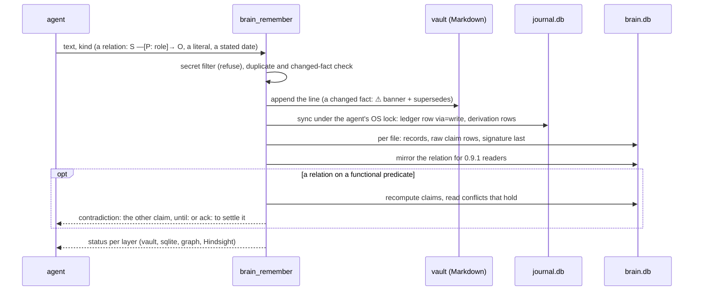
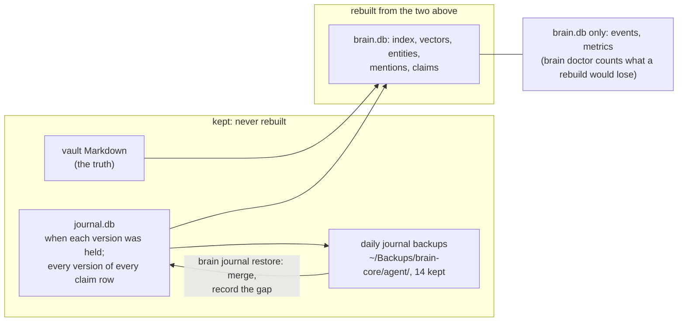

# Architecture (0.17.0)

How brain-core is built today: three tiers per agent, the sync that keeps them in step, and the write and recall paths. The design reasoning is in `KNOWLEDGE_ARCHITECTURE_AUDIT.md`. What shipped when, and how it was measured, is in `KNOWLEDGE_PROGRAM_STATUS.md`. M5 (model extraction) and M6 (a Neo4j bench) were left out by the owner's decision; nothing here depends on them.

## The system

Each agent has its own vault, its own two databases and its own MCP server process. The installed tool and the optional embedding worker are shared by every agent on the machine.

```mermaid
flowchart LR
  agent["AI agent<br/>(Claude Code)"]
  hooks["hooks and cron<br/>brief · capture · lessons · daily / weekly"]
  subgraph mcp["brain serve: 5 MCP tools"]
    tools["brain_session · brain_recall · brain_remember<br/>brain_distill · brain_status"]
  end
  subgraph canon["canonical: the vault (Markdown)"]
    v1["facts · patterns · decisions · corrections"]
    v2["relations.md · entities/*.md"]
    v3["record_meta.md · claim_reviews.md"]
    v4["sessions/ · knowledge/ · raw/ · _reflections.md"]
    ro["read-only notes and archive folders"]
  end
  subgraph journal["journal: data/journal.db (never rebuilt)"]
    j1["record_ledger · ledger_occurrences · ledger_gaps"]
    j2["derivation_journal · journal_meta"]
  end
  subgraph derived["derived: data/brain.db (rebuildable)"]
    d1["records_fts · record_vectors · relations mirror"]
    d2["entities · aliases · mentions"]
    d3["claim_raw → claims · evidence · periods · conflicts · reviews · redirects"]
    d4["events · metrics (not derived)"]
  end
  worker["embed worker<br/>Qwen3-Embedding-0.6B, one per machine"]
  hindsight["Hindsight (optional)"]
  agent --> tools
  hooks --> tools
  tools --> canon
  canon -- "sync: journal first" --> journal
  canon -- "then brain.db" --> derived
  journal -. "recording times" .-> derived
  derived --> worker
  tools -. "optional" .-> hindsight
```



## Writing a memory

`brain_remember` files the line in the vault, then syncs. The vault append and the two database commits are separate steps, not one transaction. A crash between them is repaired by the next sync, which records the line late (as an ingest), never early.



A relation stated in `relations.md` becomes an accepted claim. One found in a notes folder, or drawn by a reflection, stays a candidate until the relation is stated in `relations.md`.

## Recalling

```mermaid
flowchart TB
  q["question (+ as_of)"] --> sync["sync: changed files only"]
  sync --> kw["keyword net<br/>FTS5 bm25 + search keys"]
  sync --> vec["vector net<br/>(when stores.vectors is set)"]
  sync --> day["date net<br/>(a day named in the question)"]
  sync --> seeds["seeds: names a note holds as an alias,<br/>or a claim names; a shared name is reported"]
  seeds --> walk["bounded walk over accepted claims<br/>2 hops, scan / fan / hub / edge bounds, every cut reported<br/>only claims TRUE on as_of or today; questions about change<br/>keep ended claims and leave undated ones out"]
  walk --> graph["graph net: the walked claims' evidence<br/>by hop, then words shared with the question"]
  kw --> rrf["rank fusion, RRF c=10"]
  vec --> rrf
  day --> rrf
  graph --> rrf
  rrf --> pin["exact-identifier pin"]
  pin --> cur["supersession: current above old<br/>(with as_of, the value of that day leads)"]
  cur --> judge["model judge (optional, off by default)"]
  judge --> cap["token cap"]
  cap --> out["results: source, date, found_by, path,<br/>after_as_of / as_of_validity<br/>+ claims block (≤ 10: validity, undated, disputed_with)<br/>+ graph note, weak_match"]
```

With `recall.graph: false` the graph net is off and recall is 0.14.0's.

## Storage and durability



- **History that no Markdown file holds lives in `journal.db`.** That is the time brain-core first held each version, and every version of the rows claims come from. A journal starts at its epoch, and a restore records the window it lost. `brain journal status`, `brain doctor` and `brain index --check` report that coverage apart from consistency.
- **`known_at`** gives the evidence of a past moment, read with today's entity notes and ontology. Those have no history of their own, so a merge or rename made later applies to it.
- **Rebuilding.** Deleting `brain.db` rebuilds it from the vault and the journal, except the events and metrics, which only it holds.
- **Trust.** Text read from notes, reviews and reflections is masked for credentials before it is stored. What the hooks inject into the agent's context says it is stored data. Threat-model gates 1 to 3 are built for claims, gates 4 and 5 for all memory, and gate 6 is planned (`THREAT_MODEL.md`).
